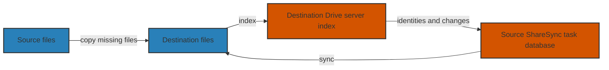

# Restoring Synology Drive ShareSync without syncing everything again

Recently I had to rebuild the storage on one of my DSM machines. I had another
copy of the shared folders on a second machine, so the files themselves were not
lost. However, the ShareSync database had also been reset, and I did not want to
transfer or hash terabytes of photos again just to convince DSM that the files
were already there.

This turned out to be more complicated than copying the files back. Here are
some notes on what we did, including the parts that worked and the parts that
still need some caution.

> **A warning before we start:** Some of the database work below uses internal,
> undocumented Synology Drive structures. This is not a copy-and-paste recipe
> for another DSM installation. A wrong database edit or an incorrectly chosen
> sync direction can cause real files to be overwritten or deleted. Keep a
> verified independent backup, test on disposable data, and make sure you
> understand the deletion and conflict behavior before touching production.

## What are we actually restoring?

My setup has two DSM machines: a source running the ShareSync client and a
destination running Drive Server. For an example shared folder, the relevant
pieces look like this:



The important point is that **the files, the server index, and the client task
database are three different things**. Copying a file to the destination does not
necessarily create a corresponding entry in the Drive index immediately. Even
when it does, the source may not yet have a ShareSync record for it.
Conversely, an index can still contain stale entries for files that are no longer on disk.

For example, the paths could look like this:

| | Source (client) | Destination (server) |
|---|---|---|
| Shared folder | `/volume1/example-share` | `/volume2/example-share` |
| Drive database | `/volume1/@SynologyDriveShareSync/session/11/db/event-db.sqlite` | `/volume2/@synologydrive/@sync/view/2/view-db.sqlite` |

The folder name is a placeholder. The task ID `11`, view ID `2`, volume
numbers, and database layout are examples from this installation. Do not
assume they are the same on yours.

## First, get the files back

We compared the two sides, kept existing files and destination-only content, and copied the missing files rather than blindly replacing the whole
share. We also kept the normal exclusions, recycle-bin contents, and other
applications' data out of the way. It is worth deciding which side is
authoritative and what to do with conflicts *before* enabling sync.

For this restore, this meant publishing 20,358 missing files, about 3.65 TB
in total. Of these, 2,933 were independently SHA-256 checked on the
destination; the rest were checked using the rsync transfer and metadata, not an independent full
readback. This was not a full-share content comparison. Matching file names,
sizes, and timestamps alone are not proof that the contents are identical.

While restoring, avoid letting two sync programs write to the same tree. We
paused the overlapping Syncthing tasks and used ShareSync only after reviewing
its settings and filters. In particular, the Immich album links had to be
considered separately from excluded Immich internal directories. A general
rule such as “ignore all hidden files” would not have been appropriate here.

## Make Drive notice existing files

Under normal circumstances, Drive should index filesystem changes and
ShareSync should populate its own records as it sees them. In a disposable test,
DSM created the client records for an identical pre-existing 32 MiB file on
both machines. The measured connection traffic was about 104 KB in total, so
it clearly did not transfer another full 32 MiB in that test. A separate small
fresh-task test likewise transferred roughly the size of the file that was
actually missing, not the entire common dataset.

This is encouraging, but it does not mean that every existing file will be
recognized without hashing, that conflicts cannot occur, or that a large
production tree will behave exactly like the test. In another test, files with
the same name, size, and timestamp but different contents produced conflict
copies. Let the native indexer finish and inspect a small test before deciding
whether any manual work is needed.

### When the index is stale

We found that the destination was not detecting some local changes. Even after
ten minutes, local writes and File Station changes in a disposable share had
not reached the source, while ShareSync still said “up to date”. The culprit in this setup was a masked
and inactive `synotifyd.service`. After restoring the service, new changes in
the test propagated automatically. Older changes made while it was masked still
needed a rescan.

On the Drive server, you can first check the service without changing anything:

```shell
systemctl status synotifyd.service
systemctl is-enabled synotifyd.service
```

If it is masked, investigate why before unmasking or starting it: this is a
system-wide service, not a setting for just one shared folder. It can affect
other Drive folders and clients too.

For a **targeted** index refresh, the command used on the destination was:

```shell
/var/packages/SynologyDrive/target/bin/cloud-control synotifyd-rescan \
  --view_id 2 --path /example-subfolder --rescan
```

Here `2` is the *server view ID*, and the path is relative to that view's root,
not the absolute `/volume2/example-share/...` path. Verify the ID and the
syntax on your installed version first. This is an internal command, and a rescan is not just a
cosmetic refresh: it can add or remove index records and generate events for
other clients. Pause and protect the relevant tasks, check other clients, and
have backups before using it. In our album test it removed 29 stale index
entries for files absent on the destination; it did not itself transfer those
files. The files that were present remained unchanged in that test.

To observe the server's native indexing queue, the installed DSM version also
provided this read-only API:

```shell
/usr/syno/bin/synowebapi --exec \
  api=SYNO.SynologyDrive.Index method=get_native_client_status \
  version=1 runner=admin
```

On our version, `num_of_event` and `time_to_resume` were used by DSM's own tray
UI to indicate whether indexing was caught up. This is a **Drive-wide** event
counter, not a count of remaining files in a particular shared folder and not
proof that ShareSync has finished. Check the actual target paths and ShareSync task separately. These
internal APIs may change between versions.

## Populating missing ShareSync items

After the file copy and server indexing, the source still lacked client
records for some of the restored files. We could let native sync handle them, but I wanted
to avoid unnecessary work on files that had already been copied. We therefore
tested generating records in an isolated task, and then performed a narrowly
scoped production repair.

The short version is: **use the real server identities, not invented file IDs**.
The destination Drive view contains a `node_table`, while the source's task
database contains
an `event_table`. A usable client record needs more than a path: it also needs
the server's file and parent identities, permanent link, sync IDs, metadata,
and a correctly represented parent directory. For my version, the mapping
included:

| Client `event_table` | Destination view or local observation |
|---|---|
| `path`, `server_file_name`, `local_file_name` | Exact relative path and names |
| `fileType`, `isExist` | Server node type and confirmation that the node and local path exist |
| `fileId`, `parentId`, `permanentLink` | Server `permanent_id`, `parent_permanent_id`, and `permanent_link` |
| `syncID`, `maxSyncID` | Server `sync_id` and `max_id` |
| `fileSize`, `fileModTime`, `fileCheckSum` | Indexed server size, mtime, and stored hash |
| `localFileModTime`, `execBit` | Observed source file metadata |
| `serverUnixUid`, `serverUnixGid`, `serverUnixMode` and server ACL fields | The corresponding recorded server metadata |

These are **observed fields in this installation**, not a complete schema or a
universal set of defaults. We also had to handle ACL and other fields according
to the actual version. The stored hash was treated as an opaque server value,
not as a new independent verification of the copied file.

The procedure we used was roughly:

1. Pause the relevant connection, protect both the actual files and the Drive
   databases/configuration, and obtain coherent private copies of the client
   task DB and server view DB. A live SQLite database may have committed data
   in its `-wal` file; copying only the main file is not a reliable backup.
   Use a quiesced service or a validated atomic snapshot/SQLite backup process,
   check integrity, and keep an independent backup as well. A same-volume Btrfs
   snapshot is useful for rollback but is not an independent backup.
2. Compare the selected restored paths with the client records and current
   server nodes. Exclude missing, ambiguous, removed, filtered, or mismatched
   entries. Check the server IDs, parent chain, file type, size and timestamps,
   and recheck the selected paths without following symlinks. I accepted the
   risk of not rehashing the already-copied files; that assumption is not proof
   of content equality.
3. Build and validate the proposed rows in a **private copy** first, with
   parents before children. Check the exact schema, row counts, SQLite integrity,
   existing records, and all other tables. Do not replace existing entries just
   because the filenames match.
4. Stop the relevant client service and verify no process is using the task DB.
   After rechecking the task state, backup, plan and identities, insert only
   the approved missing rows in a single guarded SQLite transaction. Compare a
   new private post-edit snapshot with the validated candidate before starting
   the service again. If the result of a transaction is uncertain, investigate;
   do not simply run it a second time.
5. Resume in the intended direction, watch the actual events, and test with a
   small, uniquely named file. Check both the received bytes and permissions.
   Test deletions separately, only after deciding what deletion behavior is
   intended and protecting the destination-only files.

The shape of the production transaction was the following. This is
**pseudocode**, not executable SQL: the column list, candidate, primary keys,
checks, and expected count must come from the exact validated databases.

```sql
-- Only after the service is stopped and the private copies are validated
PRAGMA synchronous=FULL;
BEGIN IMMEDIATE;
INSERT INTO main.event_table (<all_columns>)
SELECT <candidate_columns>
FROM candidate.event_table AS n
LEFT JOIN prior.event_table AS o ON n.id = o.id
WHERE o.id IS NULL
ORDER BY n.id;
-- Verify changes() equals the approved count; otherwise ROLLBACK.
COMMIT;
```

Here `prior` is the stopped pre-edit snapshot, and `candidate` is the privately
constructed and checked database. This pattern does not figure out identities
or validate files on its own; those checks have to happen before the insert.
It also does not replace the independent post-edit comparison.

For the actual shared-folder repair, 38 eligible records had already appeared through
native sync by the time the final candidate was prepared. We inserted the
remaining 10,391 file records and 11 directory records, without changing
pre-existing event rows in that transaction. A new test file then made it from
the source to the destination with matching bytes. This demonstrated a bounded upload/add test,
not complete two-way behavior or equality of the whole shared folder.

There was also a separate, narrowly scoped experiment updating cached server
metadata on existing records to reduce unwanted processing. It did **not**
solve every two-way event: subsequent native processing changed some source file and directory modes. In other words, even a successful database integrity check
is not enough to prove that permissions or future sync behavior are correct.

## Forcing a status update is not the same as fixing sync

The normal ShareSync session refresh can refresh the displayed share list; we
used it to remove stale test entries from the listing. On the source, our
installed version exposed the following internal API. The connection ID was `1` in my
case; confirm it for your own connection rather than assuming it is the same.

```shell
# On the ShareSync client: ask it to refresh the session list
/usr/syno/bin/synowebapi --exec \
  api=SYNO.SynologyDriveShareSync.Session method=refresh version=1 \
  runner=admin conn_id=1 fast_monitor=true

# Then inspect the refreshed sessions
/usr/syno/bin/synowebapi --exec \
  api=SYNO.SynologyDriveShareSync.Session method=list version=1 \
  runner=admin conn_id=1
```

This is not a read-only status check: `refresh` asks ShareSync to update its
session information. It is also not a database repair or a forced
reconciliation of every file. Similarly, a targeted server rescan asks Drive to
reconsider the filesystem, but does not magically mark both sides as identical.
Resuming the task then allows ShareSync to process the resulting work under its
configured direction and filters. Check `status`, `unfinished_files`, and
`db_error` over time rather than relying on one response.

**Do not force a green status by clearing `event_status`, advancing global
cursors or directory markers, or inventing IDs.** That can hide real changes or
deletions. In our tests, a task could report up to date even when the server
had not noticed changes; a zero queue while paused is especially uninformative.
A queue count is also not a count of bytes actually transferred.

For another shared folder, we eventually resumed two-way sync with
`ignore_local_remove=true` as a protection for destination-only files. With
that setting, source-side deletions are not propagated to the
destination, so “up to date” did not mean that full two-way deletion behavior had been verified. In an earlier
point-in-time check, four restored shared-folder tasks all reported up to date
with no unfinished items or database errors; that was a status observation, not
a proof of current status or complete content equality.

My takeaway is that the native indexer is the first thing to try, and a scoped
rescan is useful when it has missed changes. Manual database population can save
work in a carefully controlled restoration, but it is a last resort, not a
substitute for backups, correct service health, and actual create/change/delete
tests.
