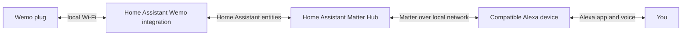

# Bringing Wemo plugs back to Alexa with Home Assistant and Matter

A perfectly usable smart plug should not become useless just because its cloud
service goes away. This guide puts a compatible Wemo device on Wi-Fi with
[pyWeMo](https://github.com/pywemo/pywemo), lets Home Assistant control it on the
local network, and uses a Matter bridge to make the switch available to Alexa.

This is a guide based on the projects' documentation and my Home Assistant
setup, not a claim that every step has been tested on every Wemo model. The
Wemo device must support local control and, if it needs Wi-Fi setup, pyWeMo
setup. Check the [pyWeMo product status list](https://github.com/pywemo/pywemo/wiki/Device-Status-Registry)
before starting. Interface names may change with software versions.

## How the pieces fit together



**pyWeMo is not the Matter bridge.** In this walkthrough, it is a Python tool
for connecting the Wemo to Wi-Fi without the Wemo app. After that, Home
Assistant's Wemo integration controls the plug. The community
[Home-Assistant-Matter-Hub](https://github.com/RiDDiX/home-assistant-matter-hub)
then exposes selected Home Assistant entities to Alexa as bridged Matter
devices. The plug itself does not become a native Matter device.

My Home Assistant runs on an always-on server and already has a Matter bridge
commissioned to Alexa. If you already have a working bridge, you can reuse it;
you do not need to reset it just to add one more switch.

## What you need

- A compatible Wemo device and a 2.4 GHz Wi-Fi network. The pyWeMo setup
  documentation specifies WPA2/AES; WPA3-only networks may not work.
- Home Assistant with network access to the Wemo. Home Assistant OS is assumed
  for the Matter Hub installation below.
- An Amazon device that supports Matter, set up with the Alexa app. The app or
  a third-party Alexa speaker alone is not necessarily a Matter controller.
- A computer with Python 3 and Wi-Fi, for initial setup only. You can skip the
  pyWeMo steps if the Wemo is already on the right network.
- Working local IPv6 and multicast discovery between the Matter bridge and
  Alexa controller. Separate VLANs and client isolation need extra care.

> **Safety first:** Choose a harmless lamp for testing. Do not test by cutting
> power to a computer, router, medical device, or anything else that should
> not be abruptly shut down. Resetting a Wemo can remove its existing Wi-Fi
> settings, name, or rules. Check the model-specific reset instructions first.

## 1. Install pyWeMo on a computer

While the computer still has Internet access, create a Python virtual
environment and install pyWeMo. For macOS or Linux:

```bash
python3 -m venv ~/wemo-setup
source ~/wemo-setup/bin/activate
python -m pip install pywemo
```

On Windows, activate the environment using its `Scripts` activation command.
You do not need to install this environment on Home Assistant. Keep the
terminal open; the computer may lose Internet access temporarily when it joins
the plug's setup network.

## 2. Connect the Wemo to your Wi-Fi

If the plug is already on the desired Wi-Fi, **skip to step 3**. Otherwise:

1. Put the plug into Wi-Fi setup mode using the instructions for its specific
   model. A factory reset may be necessary, but it can erase saved settings;
   don't reset a working device just to follow this guide.
2. On the computer, join the Wi-Fi network broadcast by the plug. Its name
   usually starts with `WeMo.`. It is normal for this network to have no
   Internet access. Disconnect a VPN or another network interface temporarily
   if it interferes with discovery.
3. In the activated terminal, start Python:

   ```bash
   python
   ```

4. Discover the device and inspect the results:

   ```python
   import pywemo
   devices = pywemo.discover_devices()
   print(devices)
   ```

   Make sure the list contains **the plug you intend to configure**. If it
   contains exactly one matching device, select it:

   ```python
   device = devices[0]
   print(device)
   ```

   If there are multiple results, select the correct index instead. If the
   list is empty, the [pyWeMo README](https://github.com/pywemo/pywemo#if-discovery-doesnt-work-on-your-network)
   describes connecting using the plug's setup-network IP address. For example,
   if the setup network's gateway is `10.22.22.1` (verify this in your Wi-Fi
   network details), use:

   ```python
   url = pywemo.setup_url_for_address("10.22.22.1")
   device = pywemo.discovery.device_from_description(url)
   print(device)
   ```

   Replace the example address with the actual setup-network gateway. Make
   sure the result identifies the intended Wemo before proceeding.

5. Enter the destination Wi-Fi name and password interactively:

   ```python
   from getpass import getpass
   ssid = input("2.4 GHz Wi-Fi name: ")
   password = getpass("Wi-Fi password: ")
   result = device.setup(ssid=ssid, password=password)
   print(result)
   ```

   `getpass` avoids displaying the password while you type. Do not paste the
   password into code, screenshots, logs, or a public post. The setup network
   may disappear as the device joins your Wi-Fi; a disconnect or timeout by
   itself does not prove whether setup succeeded.
6. Exit Python with `exit()` and reconnect the computer to your normal network.
   Check the router's client list for the plug. A DHCP reservation makes its
   address predictable and is useful if discovery needs a little help.

## 3. Add the Wemo to Home Assistant

1. Go to **Settings → Devices & services** in Home Assistant and look for a
   discovered **Belkin WeMo** device or integration. Follow the UI prompts if
   shown. Give the device a clear name and put it in an area.
2. If the device is not discovered, check that Home Assistant can reach the
   plug and that the network permits discovery. The
   [Wemo integration documentation](https://www.home-assistant.io/integrations/wemo/)
   also supports static addresses in `configuration.yaml`:

   ```yaml
   wemo:
     discovery: true
     static:
       - 192.168.1.123  # Example only: replace with your plug's address
   ```

   If there is already a `wemo:` section, merge the static entry into that
   section rather than adding a second top-level key. Reserve the address in
   DHCP, check the configuration, and restart Home Assistant as needed to load
   the change. Static configuration can bypass discovery problems, but it does
   not bypass routing or firewall rules.
3. Find the new switch entity, for example `switch.example_wemo`. With a safe
   load connected, turn it on and off in Home Assistant and check the physical
   device. Also test the plug's physical button and see whether the Home
   Assistant state follows it.

If the entity is unavailable or physical state updates are missing, the Wemo
docs call out incoming **TCP port 8989** on Home Assistant for device updates.
They also explain that local push may not work across subnets and that polling
can be used as a fallback, with delayed updates and limitations for some
features. Avoid opening this port to the Internet.

## 4. Install the Matter bridge in Home Assistant OS

If you already have a commissioned Home Assistant Matter Hub bridge, **skip
installation** and move on to step 5. Preserve its existing configuration and
pairing; installing another fork is not a necessary way to add a plug.

For a new installation, this example uses the community-maintained RiDDiX
fork. The original t0bst4r project was discontinued and archived; check the
fork's [installation guide](https://riddix.github.io/home-assistant-matter-hub/getting-started/installation)
for current requirements and, if migrating an existing installation, its
migration instructions first.

1. In Home Assistant OS, open **Settings → Apps** (called **Add-ons** in some
   versions), then open the app/add-on store.
2. Open the three-dot menu → **Repositories**, and add:

   ```text
   https://github.com/riddix/home-assistant-addons
   ```

3. Refresh the store, find the stable **Home-Assistant-Matter-Hub** app, and
   install it. Start it and open its web UI. For Home Assistant deployments
   without the app/add-on store, use the project's separate Docker or manual
   installation instructions instead.

This is a third-party bridge that publishes Home Assistant entities; it is
not the Home Assistant Matter Server used to *add* Matter devices to Home
Assistant. Protect access to its UI and backups. Pairing codes and access
tokens are secrets, not things to put in screenshots or a public repository.

## 5. Choose which entities the bridge exposes

In the Matter Hub web UI:

1. For a new bridge, open **Bridges**, create a bridge, and give it a name.
   The project recommends port **5540** for an Alexa bridge; check that it is
   available. Do not change the port of an existing working bridge just to
   match this example.
2. Configure an **include** filter for only the Wemo switch entity you want to
   expose. A `pattern` filter can match the exact entity ID, for example
   `switch.example_wemo` (replace it with yours). You can add further exact
   entity IDs or use carefully chosen entity labels later.
3. Review the bridge's entity list and save. It should show the intended
   switch, not every switch in the house. An entity that can shut down a server
   or control a sensitive load should not be exposed accidentally.

For an **existing bridge**, add the new switch to its existing include rules
instead of replacing the rules. Check that the existing entities remain in the
list before saving. Depending on the bridge version, entity or label changes
may require a refresh, an edit/save, or an app restart to appear. Follow the
[bridge configuration guide](https://riddix.github.io/home-assistant-matter-hub/getting-started/bridge-configuration)
for your installed version.

## 6. Pair the bridge with Alexa

If this bridge is already paired with Alexa, **do not pair it again**. After
the new entity appears in Matter Hub, allow Alexa time to discover it; use
Alexa's device discovery if necessary, then continue to step 7.

For a new, unpaired bridge:

1. In Matter Hub, open the bridge and display its Matter pairing QR code or
   manual setup code. Keep the code private.
2. Open the Alexa app on your phone. Choose **Add Device**, select **Matter**,
   and follow the prompts to scan the QR code or enter the numeric code. If
   the code is displayed on the same phone, use the manual-code option.
3. Complete pairing, then allow Alexa to discover the bridge's devices. Assign
   the Wemo switch a clear name and room if desired.

The controller, bridge, and phone need appropriate local connectivity during
commissioning. A bridge previously commissioned to another Matter ecosystem
may need a new *sharing* code from that ecosystem rather than reusing its
original QR code; see the project's
[multi-controller guide](https://riddix.github.io/home-assistant-matter-hub/guides/connect-multiple-fabrics).

## 7. Test the complete path

With the harmless test load connected:

1. Turn the switch on and off in Home Assistant. Confirm the plug responds.
2. Turn it on and off from the Alexa app. Confirm both the plug and Home
   Assistant state follow.
3. Try a voice command such as “Alexa, turn on the reading lamp,” then turn it
   off again. If there are duplicates from an older integration, identify which
   entry is the new bridged device before changing names or routines.

This layered test tells you where to look: if Home Assistant cannot control the
plug, fix the Wemo/network side first; if Home Assistant works but Alexa does
not, inspect the bridge and Matter connection. No successful end-to-end voice
control is implied until you actually test it.

## Troubleshooting checklist

- **No Wemo setup network:** Verify the model-specific setup/reset procedure and
  make sure the device is not already configured. Factory reset is a last
  resort when preserving existing settings matters.
- **Cannot join home Wi-Fi:** Check 2.4 GHz, WPA2/AES, password, and signal
  strength. Some devices struggle when 2.4 and 5 GHz share a name; consult
  pyWeMo's setup troubleshooting before changing router settings.
- **Wemo works in neither Home Assistant nor pyWeMo:** Confirm the device's
  address and local network reachability; check the supported-model list.
- **Home Assistant works but the bridge does not list the switch:** Check the
  entity ID, include/exclude filters, and whether the app needs a refresh.
- **Alexa cannot pair or the bridge is offline:** Check the compatible Amazon
  controller, local IPv6, mDNS/UDP, firewall and VLAN rules, bridge logs, and
  the project's troubleshooting guide. Do not forward Matter ports from the
  Internet. If an existing bridge works, preserve its pairing while debugging.
- **Alexa controls the wrong device:** Look for duplicate device names or old
  Wemo skill entries. Review any affected routines before removing anything.

The Wemo-to-Home-Assistant and bridge-to-controller links are local, but that
does not guarantee that every Alexa app or voice feature works without Amazon's
services or an Internet connection. The bridge and Home Assistant also need to
stay running for Alexa to reach the plug through this path.

## References

- [pyWeMo: setup, discovery, supported devices, and troubleshooting](https://github.com/pywemo/pywemo)
- [Home Assistant: Belkin WeMo integration](https://www.home-assistant.io/integrations/wemo/)
- [Home Assistant Matter Hub: installation](https://riddix.github.io/home-assistant-matter-hub/getting-started/installation)
- [Home Assistant Matter Hub: bridge configuration](https://riddix.github.io/home-assistant-matter-hub/getting-started/bridge-configuration)
